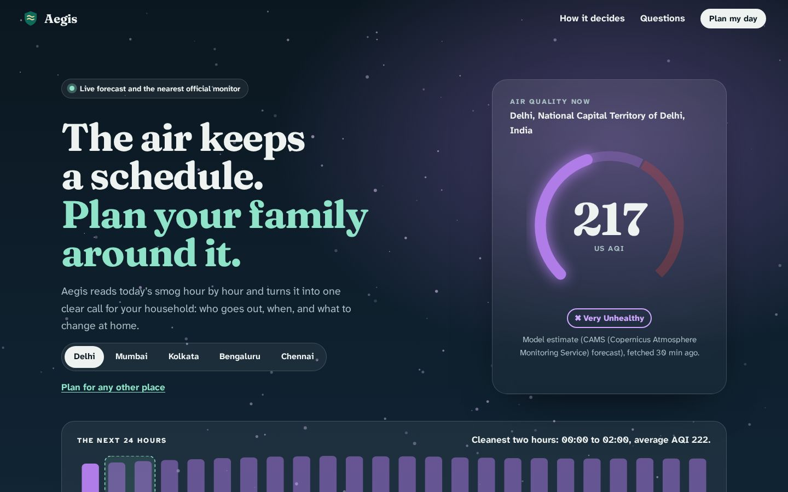
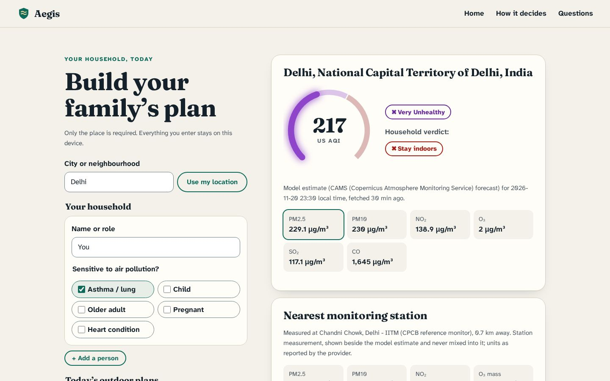
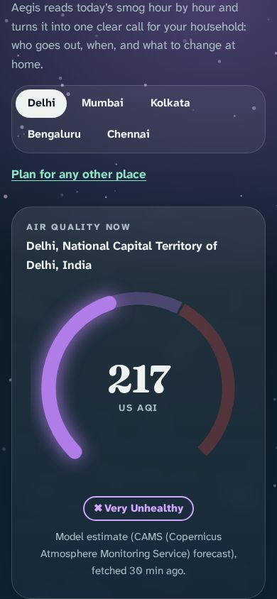

# Aegis – Urban Air Quality Assistant

[](https://github.com/Reshma-04sk/Aegis-ai/actions/workflows/ci.yml)
[](https://github.com/Reshma-04sk/Aegis-ai/actions/workflows/codeql.yml)

**Live:** https://aegis-ai-6617.onrender.com · **Planner:** https://aegis-ai-6617.onrender.com/plan
· **Challenge:** PromptWars Virtual, Challenge 6, *Urban Air Quality Assistant*

> One AQI number tells nobody what to do. **Aegis plans a household's day around the smog:** who
> in the family should go out and when, how to keep the air at home clean, and what a greener
> commute changes, with every number's source and age shown.



The live site runs on Render's free tier: after a quiet spell the first request can take about
50 seconds while the service wakes; after that pages load in well under a second.

## Try it in one minute
1. Open the [live site](https://aegis-ai-6617.onrender.com). Delhi's air loads into the ring:
   the US AQI, its EPA category as text and icon, and how old the estimate is.
2. Switch city (Mumbai, Kolkata, Bengaluru, Chennai). The sky's glow and the haze change with
   the air. Drag across the 24-hour strip, or focus the slider and use the arrow keys, to read
   any hour in words.
3. Press **Plan a day in Delhi**. Tick **Asthma / lung**, add a person or an evening walk, and
   press **Plan my day**. Each person gets a call, each outing gets its cleanest hours with the
   PM2.5 saved by waiting, and the briefing is rewritten by Gemini without changing a number.
4. Open **Home and purifier** and **Daily commute** for purifier sizing and the commute table,
   where climate impact (kg CO2e per week) and your own exposure (µg PM2.5 per trip) sit in
   separate columns.

<p>


</p>

## What it does
| Need from the problem statement | How Aegis answers it |
|---|---|
| Health guidance for sensitive groups | A verdict per member (**Go / Take care / Limit / Stay indoors**) from the EPA AQI category descriptions. Sensitive groups are treated one category stricter, hard exercise one step stricter again, and the household follows its strictest member. |
| A low-exposure daily routine | Each planned activity is placed in its cleanest forecast hours within its own time limits. The benefit is shown as PM2.5 breathed in during the chosen slot versus going now (EPA inhalation rates for the activity). If the air is bad all day, Aegis says so and suggests doing it indoors. |
| Cleaner air indoors | Purifier sizing (EPA chart), clean-air changes per hour, time to cut particles by 90%, the best hour to air the home, and smog-season habits. |
| A greener commute, honestly | kg CO2e per week for each travel mode (UK DESNZ 2026 factors), **kept separate from** the PM2.5 you breathe per trip (EPA Exposure Factors Handbook). On a smoggy day cycling cuts emissions but raises exposure, and both are shown. |
| A personal, plain-language briefing | Google Gemini (`gemini-3.5-flash-lite`) rewrites the computed plan in plain words. A rule-based briefing shows at once and is replaced when Gemini answers. |

## Evidence
| Criterion | Measured | Details |
|---|---|---|
| Efficiency | Lighthouse (PageSpeed Insights, live site): Performance **99** mobile and **100** desktop on `/`, **100** on both for `/plan`; LCP 0.8 s mobile, 0.2 s desktop; TBT 0–20 ms; CLS ≤ 0.002 | [EFFICIENCY.md](EFFICIENCY.md) |
| Accessibility | Lighthouse **100** on all four runs; zero axe WCAG 2.1 AA violations at 1440 px and 375 px | [ACCESSIBILITY.md](ACCESSIBILITY.md) |
| Testing | 375 backend tests at **100%** coverage (incl. property-based, API fuzzing and code-convention checks), 48 front-end tests at 96%, 32 browser tests, OWASP ZAP scan | [TESTING.md](TESTING.md) |
| Code quality | mypy strict and TypeScript strict with type-aware ESLint; complexity ≤ 6; small modules, enforced in CI | [CODE_QUALITY.md](CODE_QUALITY.md) |
| Security | Strict CSP with Trusted Types, Lighthouse Best Practices **100**, decisions immune to prompt injection, CodeQL, dependency audits | [SECURITY.md](SECURITY.md) |
| Problem alignment | 16 requirements traced to code and tests; SEO **100** | [PROBLEM_ALIGNMENT.md](PROBLEM_ALIGNMENT.md) |

Design decisions are recorded in [docs/adr](docs/adr): rules decide and AI explains; forecast
and measurement stay separate; a prerendered React front end; CSP with Trusted Types.

## How it works
```
Browser ──▶ POST /api/plan ──▶ Open-Meteo geocoding + CAMS air quality + weather (TTL cache)
                           ──▶ OpenAQ nearest station, latest measurements (TTL cache, optional)
                           ──▶ rules/ · planner/ · indoor.py · commute/ (deterministic)
                           ◀── plan + rule-based briefing + one-time briefing_id
        ──▶ POST /api/briefing/{id} ──▶ Gemini rewrites the briefing (never the numbers)
```
Request and response reference: [docs/api.md](docs/api.md).

| Layer | Stack |
|---|---|
| API | Python 3.14, FastAPI (async), Pydantic v2 as the contract, httpx with bounded retries, in-memory TTL caches |
| Decisions | Pure Python engines (`rules/`, `planner/`, `indoor.py`, `commute/`, `exposure.py`) with no HTTP or model access |
| AI | Google Gemini REST API, grounded on computed facts, JSON-only output, rules fallback |
| Front end | React 19 + TypeScript (strict), built by Vite 8 and **prerendered to HTML**; GSAP + ScrollTrigger loaded on demand |
| Quality | ruff, mypy `--strict`, pytest + Hypothesis + Schemathesis; ESLint (type-aware), Vitest, Playwright + axe |
| Delivery | One Docker image (Node build stage, Python-only runtime, non-root), Render; GitHub Actions CI, CodeQL, ZAP |

## Data honesty
- **Two kinds of data, never mixed:**
  - **Model estimate:** the Copernicus CAMS forecast via Open-Meteo. It covers every location and
    drives the hourly planning.
  - **Station observation:** the nearest monitor within 25 km that reported in the last 24
    hours, via [OpenAQ](https://openaq.org) (which carries government networks such as India's
    CPCB). It is shown in its own card and tile with station, provider, distance and the
    provider's own units, and it never replaces or adjusts a model value.
- Every value shows its kind and data age; anything older than 3 hours is labelled stale.
- Missing values stay missing; nothing is filled in or invented.
- Emissions (macro impact) and inhaled dose (personal exposure) are separate fields and labels.
- No medical claims: guidance points to the person's doctor and local health authority.

## Design decisions
- **The model never decides.** Verdicts, schedules and numbers are deterministic and tested.
  Gemini only phrases the briefing; its output must be JSON of at most 700 characters with no
  links, or it is discarded. The user's note is passed as delimited, untrusted data.
- **Fast first paint.** Both pages are rendered to HTML at build time, and the plan returns
  without waiting for Gemini (which can take 5–25 s; its calls have a 25 s budget with one
  retry and a global per-minute cap).
- **One service, no database.** React builds to static files that FastAPI serves: one
  container, one set of security headers. Household details stay in the browser's
  localStorage and can be removed with "Forget saved household".
- **Motion that never lies.** React renders final values and GSAP only animates *from* a start,
  so an interrupted animation cannot leave a wrong number on screen. With
  `prefers-reduced-motion`, no animation code is downloaded at all.

## Look and feel
The landing page opens on a night sky whose glow takes the colour of the chosen city's EPA
category, with a slow haze drawn from the forecast PM2.5 (denser on dirtier days, paused off
screen). Below it: the live AQI ring, the scrubbable 24-hour strip, "Today in {city}" tiles,
what a plan settles, how Aegis decides (a line that draws itself through Sense, Decide, Explain
as you scroll), what the numbers are and are not, and questions. The planner puts the form
beside the plan on wide screens and stacks them on phones.

Palette: warm paper `#f4f1ea` and night `#0b1720`, ink `#14212b`, one pine green for actions
`#0e6b5c`; colour is otherwise reserved for the air, using EPA category colours with darker
text variants on paper and lighter ones on night so every label passes AA. Type: Fraunces for
display and figures, Atkinson Hyperlegible Next (designed for low-vision readers) for reading.
No third-party scripts or font hosts: everything is served from our own origin.

## Accessibility
Skip link, landmarks and ordered headings; every control labelled; fieldsets for grouped
choices; AQI and verdicts as number + text + icon, never colour alone; a keyboard-operable hour
scrubber whose value is spoken as text; a live results region that receives focus; the hourly
forecast also as a table; visible focus; reduced motion respected; no horizontal scroll at 375 px.

## Run it locally
Requires Python 3.14 with [uv](https://docs.astral.sh/uv/) and Node 26.
```bash
cp .env.example .env      # then add your keys (see Configuration); both are optional
uv sync
npm ci && npm run build   # builds and prerenders the front end into src/aegis/static
uv run --env-file .env uvicorn aegis.main:app --reload
# open http://localhost:8000
```

## Configuration
All settings are environment variables; `.env.example` lists them with placeholders. Secrets
are never committed.

| Variable | Default | Purpose |
|---|---|---|
| `GEMINI_API_KEY` | empty | Enables the Gemini briefing; without it the rule-based briefing is shown |
| `GEMINI_MODEL` | `gemini-3.5-flash-lite` | Gemini model id |
| `OPENAQ_API_KEY` | empty | Enables nearest-station measurements ([free key](https://explore.openaq.org/register)) |
| `TRUSTED_PROXY_HOPS` | `0` | Proxies in front of the app whose `X-Forwarded-For` hop is trusted (`1` on Render and Cloud Run) |
| `RATE_LIMIT_PER_MINUTE` | `30` | Plan and briefing requests per client per minute |
| `GEMINI_CALLS_PER_MINUTE` | `60` | Global cap on Gemini calls |
| `CACHE_TTL_SECONDS` | `600` | Forecast cache lifetime |
| `REQUEST_TIMEOUT_SECONDS` | `8` | Timeout per upstream request |

When the UI's constants change in Python (AQI bands, labels, form choices), regenerate them
with `npm run config`; a test fails if they drift.

## Checks
```bash
uv run ruff check . && uv run ruff format --check . && uv run mypy
npm ci && npm run build   # the page tests serve the built front end
uv run pytest             # 375 tests incl. property, fuzz and convention tests, 100% coverage
npm run lint && npm run typecheck && npm run format:check
npm run test:unit         # 48 Vitest tests with coverage
npx playwright install chromium
npx playwright test       # 32 browser tests at 1440 px and 375 px, incl. axe WCAG 2.1 AA
```
The browser tests run the real front end and API against fixed air data
(`tests/e2e/fixture_app.py`), so they need no network or keys. CI runs all of the above plus
`pip-audit`, `npm audit`, CodeQL and an OWASP ZAP scan on every push.

## Deploy
**Render (free):** New → Blueprint → pick this repo; `render.yaml` defines the service (Docker,
Singapore, health check `/api/health`). Add `GEMINI_API_KEY` (and optionally `OPENAQ_API_KEY`)
under the service's Environment.

**Google Cloud Run:**
```bash
gcloud run deploy aegis-ai --source . --region asia-south1 --allow-unauthenticated \
  --set-secrets GEMINI_API_KEY=gemini-api-key:latest --set-env-vars TRUSTED_PROXY_HOPS=1
```

## Code layout
| Path | Role |
|---|---|
| `src/aegis/api/` | App factory, JSON and page routes, middleware (security and cache headers), throttle |
| `src/aegis/airdata/`, `stations/` | Open-Meteo (CAMS) and OpenAQ adapters, parsers and provider ports |
| `src/aegis/rules/`, `planner/`, `indoor.py`, `commute/`, `exposure.py` | Deterministic decisions: verdicts, cleanest windows, dose, CADR, emissions |
| `src/aegis/advisor/` | Gemini briefing, grounded on plan facts, with a rules fallback |
| `src/aegis/models/` | Pydantic v2 API contract, split by domain |
| `src/aegis/frontend.py` | UI constants and form choices, written to `web/src/generated/config.json` |
| `web/src/lib/` | API types, config, formatting, chart geometry, network calls, motion |
| `web/src/components/`, `landing/`, `planner/` | Shared pieces, the landing page, the planner and its result cards |
| `web/prerender.ts`, `vite.config.ts` | The build: client bundle, server render, each page filled with its HTML |
| `tests/`, `tests/web/`, `tests/e2e/` | pytest, Vitest and Playwright suites |

## Credits and licences
- Data: Copernicus CAMS via [Open-Meteo](https://open-meteo.com) (CC BY 4.0); measurements via
  [OpenAQ](https://openaq.org), credited to each station's operator.
- Factors: UK DESNZ 2026 greenhouse-gas conversion factors; US EPA Exposure Factors Handbook;
  EPA AQI breakpoints and purifier sizing.
- Fonts: Fraunces and Atkinson Hyperlegible Next via @fontsource-variable 5.3.0 (SIL OFL 1.1).
- Motion: GSAP 3.15.1 with ScrollTrigger (GSAP Standard "no charge" license).
- Code: MIT, see [LICENSE](LICENSE).

## Limits
- CAMS is a regional forecast model, not a street-level sensor.
- Emission factors are UK averages; local fleets and power grids differ.
- Indoor numbers assume a well-mixed, closed room and are estimates, not measurements.
- The rate limiter and caches live in each process; several instances would need a shared store.
- Guidance is general and **not medical advice**.
